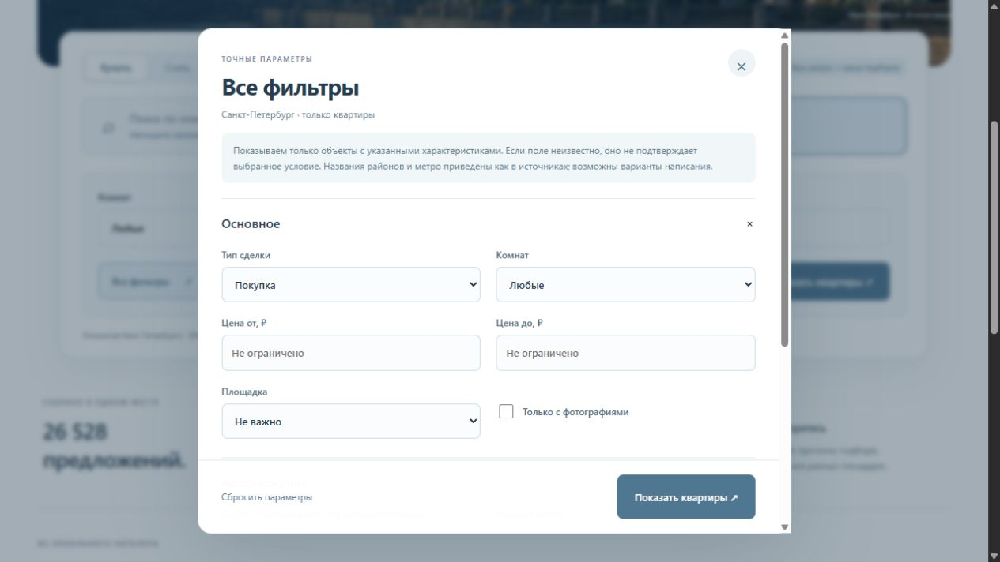

# Простор — поиск квартир в Санкт-Петербурге

Прототип веб-приложения для ВКР «Повышение конверсии пользователей риэлторской платформы за счёт поиска на естественном языке».

Пользователь задаёт условия обычной фразой или через фильтры. Система применяет обязательные ограничения, сортирует подходящие объявления и показывает причины подбора.

## Возможности

- Покупка и долгосрочная аренда квартир в Санкт-Петербурге, без Ленинградской области.
- Поиск по описанию с редактируемыми критериями; пока используется разбор по правилам.
- Фильтры цены, площади, кухни, этажа, метро, ремонта, санузла, балкона, года и типа дома.
- Карточки с фотографиями, избранное, сортировка и серверная пагинация.
- Локальный каталог SQLite и журнал поисков/взаимодействий.

**Статус: MVP 0.4.** LLM и семантическое ранжирование запланированы. Рост конверсии пока не измерен. Обязательные ограничения не ослабляются при пустой выдаче; неизвестные характеристики не считаются совпадением.

## Быстрый запуск

Требуется Node.js 24+. Дополнительные зависимости не нужны.

~~~sh
git clone https://github.com/lukerald1/vkr-realty-search.git
cd vkr-realty-search
npm start
~~~

Открыть http://127.0.0.1:3100. В Windows также доступен двойной щелчок по start.cmd. На приватный репозиторий необходим доступ.

**На свежем клоне без базы используются 12 вымышленных учебных объектов.** Реальные данные в Git не включены. Для демонстрации преподавателю отдельно подготовлена переносная сборка с 120 историческими предложениями; ей также нужен Node.js 24+. Фотографии требуют подключения к исходным CDN; при ошибке загрузки показывается иллюстрация.

## Данные

Основной локальный каталог содержит 26 528 предложений из выгрузок Metrapi: 18 987 продаж и 7 541 аренда. Это исторический снимок; актуальность проверяется на площадке-источнике. Дубли группируются по group_id, сомнительная география и повреждённые строки исключаются.

Владелец данных может построить каталог из локальных файлов:

~~~sh
node scripts/import-data.mjs "путь/продажа.jsonl" "путь/аренда.jsonl"
~~~

Перед переимпортом остановить сервер. Скрипт заменяет сгенерированный каталог, но не исходные файлы и не историю сессий. [Отчёт качества](docs/data-quality.md) · [Покрытие полей для фильтров](docs/filter-data-audit.md).

## Проверки

~~~sh
npm test
~~~

19 тестов: география, обязательные ограничения, неизвестные поля, пустая выдача, диапазоны, совпадение SQL и логики ранжирования, пагинация и изоляция событий сессий. Проверки запускаются в GitHub Actions.

## Архитектура

Браузер → HTTP API на Node.js → SQLite. Разбор запроса, каталог и адаптер Metrapi выделены в отдельные модули. Для LLM предусмотрен профиль hard/soft/unknown; реального LLM-адаптера пока нет.

| Путь | Назначение |
|---|---|
| apps/public/ | Интерфейс |
| apps/server.mjs | HTTP API |
| apps/search.mjs | Разбор запроса и фильтры |
| apps/catalog.mjs | Каталог, сортировка и пагинация |
| apps/activity.mjs | Сессии и события |
| apps/metrapi.mjs | Серверный адаптер источника |
| scripts/ | Импорт, аудит и сборка демонстрации |
| tests/ | Автоматические проверки |
| thesis/ | Структура текста ВКР |

## План и материалы

- [План развития](docs/plan.md).
- [Архитектура и интеграция LLM](docs/backend-design.md).
- [Кандидаты LLM и бюджет](docs/llm-budget.md).
- [Демонстрация и методика сравнения способов поиска](docs/mvp-review.md).
- [Документация подключения Metrapi](docs/metrapi.md).
- [Паспорт темы](https://github.com/fa-un/vkr-constructor/blob/main/cases/realt-semanticheskiy-poisk.md).

## Ограничения и безопасность

Сервер слушает только локальный интерфейс. Для публичного запуска нужны HTTPS, аутентификация и ограничение запросов. Cookie-сессия не является аккаунтом пользователя. Открытие карточки или переход к источнику не считается сделкой.

Ключи хранятся в серверном .env и не включаются в Git. Живой Metrapi включается явно через DATA_MODE=metrapi; адаптер загружает одну страницу кандидатов и не гарантирует полноту рынка. Поиск по локальной базе не вызывает платные API. Большая обложка — сгенерированная иллюстрация, не фотография конкретного объявления.
